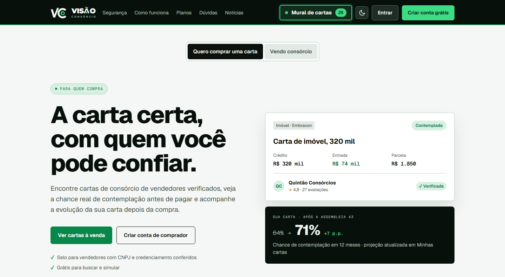
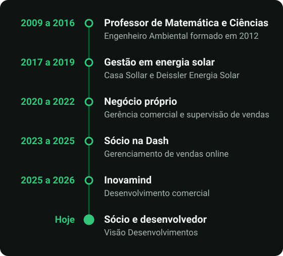

---

## 👋 Sobre mim

**Sou novo na programação, mas não em resolver problemas.** Vim da engenharia, da gestão e da sala de aula, e hoje construo software com IA no centro do processo.

- 🤝 **Sócio & desenvolvedor** na **Visão Desenvolvimentos**: desenvolvimento, automação e IA sob medida
- 🤖 Trabalho com **agentes de IA**, **automação de processos** e **sistemas web**
- 📈 Trago anos de **gestão comercial, liderança de equipes e indicadores**, inclusive como dono de negócio
- 🎓 **Engenheiro Ambiental** (FUNCESI, 2012) e ex-professor de Matemática e Ciências
- 🌎 Português nativo · Inglês intermediário · Alemão básico

> 🌱 **Fase atual:** início de carreira na programação. Ainda tenho poucos projetos publicados, com uma base sólida dos conceitos que o mercado usa e evolução constante. Desenvolvo com IA como parceira de código e respondo pelo que entrego: o problema, o escopo e o resultado.

---

## 🎯 Como posso ajudar a sua empresa

Antes de escrever código, entendo a operação: como o trabalho é feito hoje, por que é feito assim e onde o tempo se perde.

- 🤖 **IA aplicada:** agentes de atendimento e assistentes para decisões repetitivas, com escopo claro e passagem para uma pessoa quando for preciso
- ⚙️ **Automação:** fluxos que ligam WhatsApp, CRM, ERP e planilhas, com menos etapas manuais e menos retrabalho
- 💻 **Sistemas web:** sites, painéis e plataformas feitos para a operação que você já tem, no celular e no computador

**Entender** → **Mapear** → **Estruturar** → **Desenvolver** → **Evoluir**

---

## ⭐ Projeto em destaque

### [Visão Consórcio](https://visaoconsorcio.com.br)

Plataforma para quem compra e para quem vende consórcio: mural de cartas, calculadora de chance de contemplação, carteira de clientes e gestão de equipe. É um produto da Visão Desenvolvimentos, criado pelo meu sócio, [Diego Caldeira](https://github.com/diego-caldeira-12), e evoluído em conjunto.

**Onde atuei:**

- 🎨 **Interface e experiência:** repaginação das telas, da estrutura do app, da página inicial, do login e do painel
- 🗂️ **Mural de cartas:** vitrine pública e as leituras de quem compra e de quem vende
- 💳 **Planos e preços:** tabela da página inicial alimentada pelo banco de dados
- 🔐 **Conta:** correções em criar conta, recuperar e trocar senha
- 👥 **Equipe:** administração dos vendedores pela própria corretora, com migração no Postgres

`React` `TypeScript` `Vite` `Supabase` `PostgreSQL` `Cloudflare Workers`

---

## 🛠️ Ferramentas

**IA & Agentes**

**Automação & Integrações**

**Front-end**

**Back-end, Dados & Infra**

### 🧠 Conceitos por trás das ferramentas

| Área | O que entendo e aplico |
|------|------------------------|
| **IA e agentes** | Engenharia de prompt, agentes de atendimento, RAG, desenvolvimento assistido por IA |
| **Automação** | APIs, webhooks, integração entre CRM, ERP e WhatsApp, desenho de fluxos |
| **Front-end** | Interfaces responsivas, UI/UX, componentes |
| **Back-end e dados** | Banco relacional, SQL, migrações, containers, deploy |
| **Trabalho em equipe** | Git, branches e pull requests |
| **Negócio** | Mapeamento de processos, indicadores, gestão comercial, liderança, oratória |

---

## 📜 Trajetória

---

## 📊 Atividade no GitHub

<picture>
  <source media="(prefers-color-scheme: dark)" srcset="https://raw.githubusercontent.com/alequintao22/alequintao22/output/snake-dark.svg"/>
  
</picture>

<b>Ver estatísticas</b>

 

 

A maior parte do meu trabalho está em repositórios privados da empresa e não aparece nestes números.

---

### Tem um processo que toma tempo demais da sua equipe?

**[Me chame no Instagram](https://www.instagram.com/alequintao22/)** e conte como ele funciona hoje.

